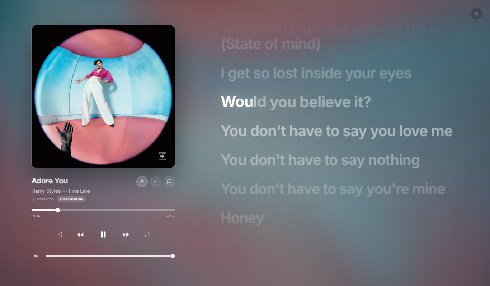
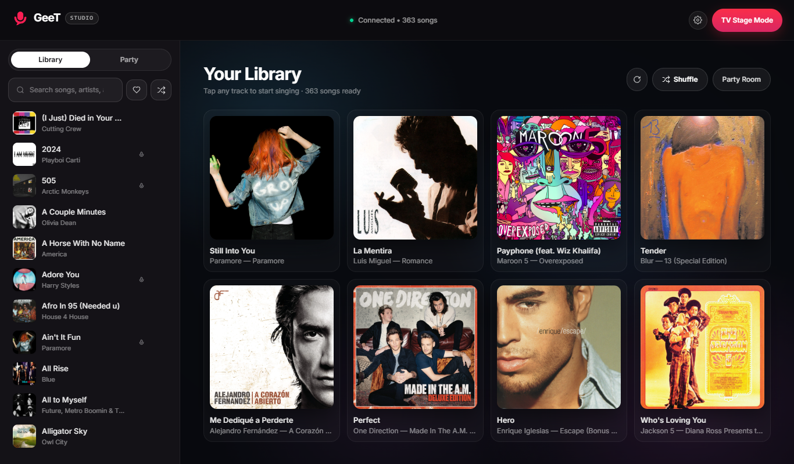
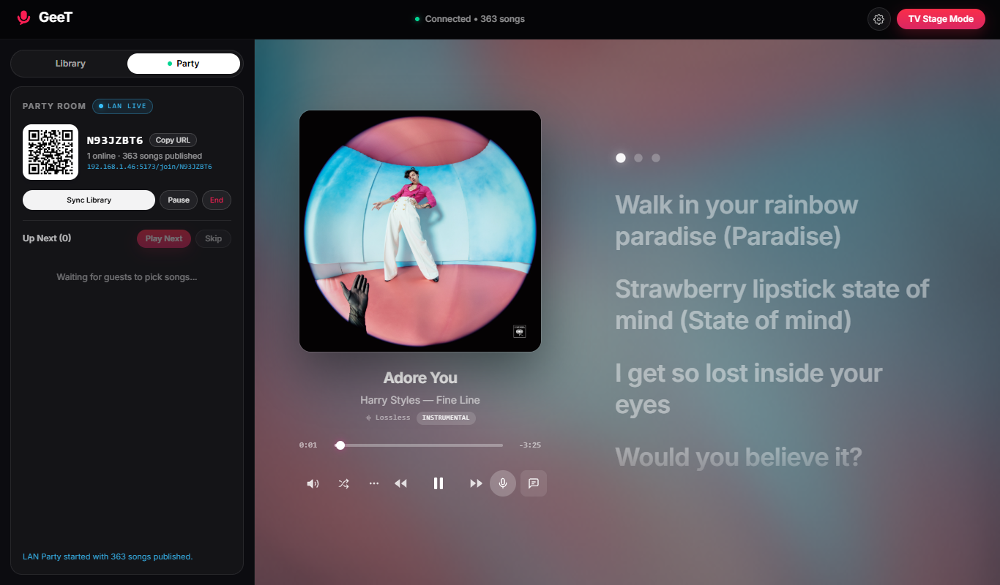
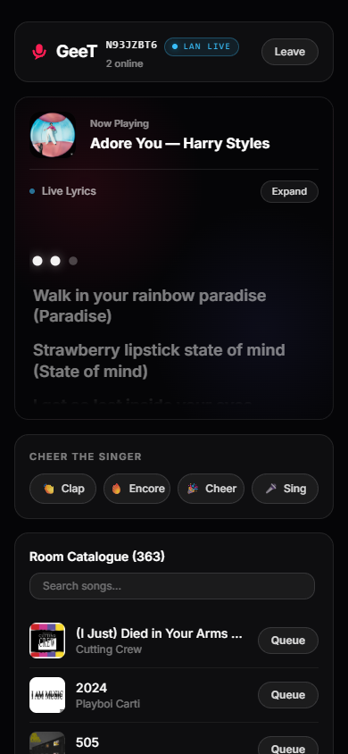
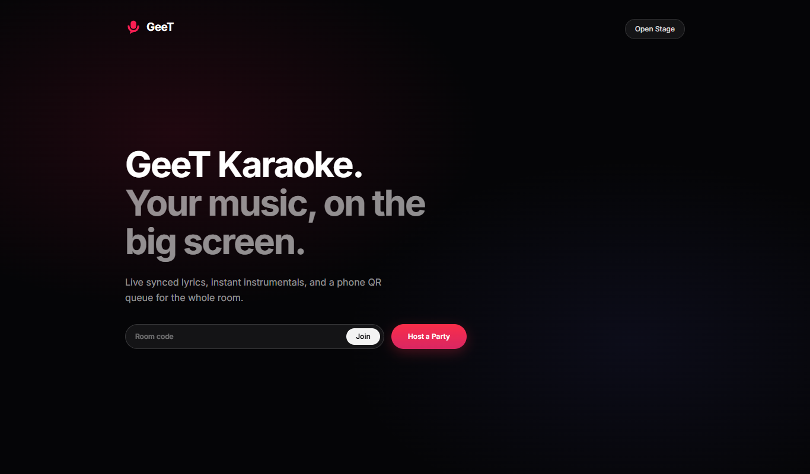

<p align="center">
  
</p>

<h1 align="center">GeeT Karaoke Platform</h1>

GeeT turns your local music library into an Apple Music Sing–inspired karaoke stage with zero recurring cloud cost:
- **Frontend**: React 19, Vite, TypeScript, Tailwind CSS, and a 60 FPS WebGL fluid album-art shader
- **Party Sync**: Zero-cloud **LAN Party Mode** (host-agent WebSockets over Wi-Fi) + optional **Supabase Free Tier** (PostgreSQL, RLS, Realtime)
- **Local Host Agent**: FastAPI, SQLite, Mutagen, bundled FFmpeg (transparent ALAC/EC-3 → cached AAC playback), and **Demucs** vocal/instrumental stem separation

Audio files, processed stems, full library paths, and local credentials remain strictly on the host system.

---

## Screenshots

### TV Stage Mode (WebGL Fluid Album-Art Backdrop & Frosted QR Overlay)


### Host Console — Library & Shuffle


### Host Console — Live Party Room


### Guest Phone Companion (Live Follow-Along Lyrics & Reactions)
<p align="center">
  
</p>

### Home


---

## Highlights
- **Apple Music Sing Stage**: Real-time WebGL fluid-warp shader (`FluidCoverCanvas`) driven by each track's embedded album art, 60 FPS lyric sweep, and 3-dot intro/interlude breather cues.
- **Smart Lyrics Pipeline**: Automatic LRCLIB synced-lyrics lookup with cleaned title/artist fallback, embedded tag fallback (`©lyr` / `USLT`), offset calibration, and offline **Devanagari → Hinglish (`अ / A`)** transliteration toggle.
- **Local Instrumental Separation & Vocal Mix**: On-device Demucs separation with live `0%–100%` guide-vocal mix slider and background Auto-Prepare for the next 1–2 queued tracks.
- **LAN & Cloud Party Rooms**: Friends scan the QR code on Wi-Fi to browse the catalogue, queue songs, send live floating reactions, get **"You're Up Next!" / "You're On Stage!"** alerts, and read **live follow-along lyrics** right on their phone.
- **Full-Library Shuffle**: Fisher-Yates bag shuffle across all indexed tracks with history navigation (`<<`), auto-advance, and automatic Party Queue priority.

---

## Project Status and Progress Overview

Overall Delivery Progress: 78% (7 of 9 roadmap phases implemented in code).

| Phase | Milestone | Status | Test & Gate Status |
| :--- | :--- | :--- | :--- |
| Phase 1 | Foundation (Monorepo, Agent Skeleton, Cloud Schema, Baseline UI) | Completed | Verified (Vitest, Pytest, Build) |
| Phase 2 | Library Indexing (Incremental Scan, Deduplication, Cursor Pagination) | Completed | Verified (100 Mixed Files Test Gate) |
| Phase 3 | Lyrics Pipeline (LRC Parser, Sidecar Import, Offset Calibration, LRCLIB Integration) | Completed | Verified (10 Timed Songs Test Gate) |
| Phase 4 | Room Lifecycle & Realtime (Guest Auth, Room Creation, QR Code, State Sync) | Completed (Code) | Unit & Build Verified (Live Cloud Gate Pending) |
| Phase 5 | Queue Management & Mutational RPCs (Atomic Ordering, Idempotency, Host Controls) | Completed (Code) | Unit & Build Verified (Live Cloud Gate Pending) |
| Phase 6 | Local Instrumental Separation (CPU/GPU Fallback, Cache Management, Preview) | Completed (Code) | Verified via Test Separator (Live Demucs/FFmpeg Pending) |
| Phase 7 | Hardening (Rate Limits, Security Headers, Backups, Quota Telemetry, E2E) | Completed (Code) | Verified (Vitest, Pytest, Chrome E2E; Live RLS/Device Pending) |
| Phase 8 | Production Deployment (Cloudflare Pages Build, Supabase Migrations, Runbooks) | Pending | Scheduled next |
| Phase 9 | Optional Low-Latency WebRTC Microphones | Pending | Experimental gate |

---

## Detailed Component Status

### 1. Ready and Implemented Components

#### Shared Contracts (`packages/shared`)
- Type definitions and Zod schemas for room records (`RoomSchema`), participants (`RoomParticipantSchema`), published room songs (`RoomSongSchema`), queue entries (`QueueEntrySchema`), playback states (`PlaybackStateSchema`), audio playback modes (`AudioModeSchema`), song readiness flags, host agent health records, paginated catalogue pages, background jobs, and lyric records.
- Standardized cross-boundary data validation between frontend and local agent.
- Token-free join URL builder (`buildJoinUrl`) ensuring zero credential leakage in QR codes and share links.

#### Lyrics Engine (`packages/lyrics`)
- Standard LRC parser supporting single and multi-timestamp records.
- Binary search indexer for zero-allocation active line resolution.
- Dynamic timeline offset engine supporting arbitrary micro-adjustments without destructive edits.

#### Local Host Agent (`services/host-agent`)
- HTTP loopback service bound strictly to `127.0.0.1:8765`, with optional `HOST_AUTH_TOKEN` (`X-Host-Token`) enforcement on mutating endpoints.
- Path traversal protection enforcing directory boundary allowlists for source media and cached stems, plus strict 16-char hex song ID validation on media routes.
- Media streaming endpoint (`/media/{song_id}?mode=original|instrumental|vocal`) with RFC 7233 partial byte-range (`206`) support for seek operations.
- DRM detection mechanism automatically rejecting `.m4p` and FairPlay-protected containers while keeping original files untouched.
- Incremental library indexing leveraging file sizes, modification timestamps, and content hash fingerprints to detect duplicates without full scans.
- SQLite job ledger tracking scanning and separation states with cancellation capabilities.
- Atomic SQLite metadata-only backup endpoint (`POST /backup`) storing backups in `HOST_DATA_DIR/backups/` without audio files.
- Timed lyrics management with automatic sidecar `.lrc` ingestion, durable manual updates, and metadata-validated LRCLIB querying.
- Local instrumental separation (`separator.py`, `POST /songs/{id}/prepare`, `POST /songs/{id}/cache/clear`):
  - Single-worker bounded background execution (`ThreadPoolExecutor(max_workers=1)`).
  - Automatic compute detection (`cuda`, `mps`, or `cpu` fallback).
  - Pre-run free disk space verification (`>= 200 MB`), stem integrity verification, atomic cache promotion, and temp cleanup on cancellation or failure.

#### Supabase Database Architecture (`supabase/migrations/`)
- Migration `0001_initial_schema.sql`: Core tables (`rooms`, `room_participants`, `room_songs`, `queue_entries`, `playback_state`), RLS enabled on all exposed tables with `SECURITY DEFINER` helpers (`SET search_path = public, pg_temp`), and base transactional RPCs.
- Migration `0002_room_realtime_and_capability.sql`: Column-level privilege revocation on `rooms.host_capability_hash`, `set_room_status` RPC, and `supabase_realtime` publication registration.
- Migration `0003_queue_and_playback_rpcs.sql`: Shared `_assert_host_capability` helper, hardened `add_song`, and host-only `reorder_queue`, `advance_queue`, and `sync_playback_checkpoint` RPCs.
- Migration `0004_hardening_and_rate_limits.sql`: `rate_limits` table and `_check_rate_limit` helper enforcing per-user rate limits on `create_room` (5/hour), `join_room` (15/5 min), and `add_song` (20/5 min).
- Security Verification (`tests/security/rls_adversarial.sql`): Rollback-safe adversarial SQL test suite verifying `anon`, non-member `authenticated`, participant, and host boundaries.

#### Room, Queue, Realtime & Quota Telemetry (`apps/web/src/lib/rooms.ts`)
- Anonymous Supabase authentication session handling (`ensureAuthSession`).
- Host room creation with session-scoped high-entropy capability storage.
- Participant room join by alphanumeric code and display name.
- Batched metadata publication (`publishRoomSongs`) in 100-song chunks, excluding private paths, audio payloads, and DRM files.
- Authoritative snapshot synchronization with revision comparison (`reconcileSnapshot`).
- Typed RPC wrappers for queue mutations and playback checkpoints, plus `moveQueueEntry`.
- Realtime channel bindings, client presence tracking, throttled broadcast reactions (max 1 per 2 s), and session quota telemetry (`getQuotaTelemetry`).

#### Web Interface & Edge Security (`apps/web`)
- React 19 application utilizing React Router and Tailwind CSS, with accessible input labels and ARIA status/alert regions.
- Host Console (`HostPage`, `HostRoomPanel`) with local playback, mode switching, lyrics sync/calibration, SQLite backup trigger, QR join, live queue controls, and Realtime quota telemetry display.
- Participant Room Interface (`RoomPage`) with session recovery, queue view, self-removal, and debounced search.
- Cloudflare Pages SPA fallback routing (`_redirects`) and security/CSP headers (`_headers`).
- Browser E2E verification (`playwright.config.ts`, `tests/e2e/smoke.spec.ts`) executing Chrome against Vite and the local host agent.

---

### 2. Pending Capabilities

1. **Phase 8 - Production Deployment**
   - Cloudflare Pages deployment guide, Supabase production setup/migrations, architecture Mermaid diagrams, backup/restore rehearsal evidence, troubleshooting guide, and known limitations report.

2. **Phase 9 - Optional WebRTC Microphones**
   - WebRTC signaling over Supabase Realtime, host Web Audio mixing, explicit mic permissions, wired-mic fallback, and measured latency gate.

---

## Directory Layout

```text
karaoke-platform/
  apps/
    web/                   # Cloudflare Pages React application
  packages/
    shared/                # Shared domain schemas and TypeScript contracts
    lyrics/                # LRC parsing and synchronized timeline engine
  services/
    host-agent/            # Python FastAPI service, SQLite, indexer, and stem separator
  supabase/
    migrations/            # Version-controlled PostgreSQL schemas, RLS, rate limits, and RPCs
    seed.sql               # Development fixtures
  tests/
    e2e/                   # Playwright Chrome end-to-end tests
    security/              # Adversarial PostgreSQL RLS verification suite
  docs/
    quotas.md              # Free-tier quota guardrails and operational constraints
```

---

## Setup and Verification

### Prerequisites
- Node.js >= 20.x and npm >= 10.x
- Python >= 3.11
- Google Chrome (for Playwright E2E)
- FFmpeg / FFprobe / Demucs (optional for local metadata via Mutagen; required for non-WAV separation)

### 1. Install Dependencies
```bash
npm install
cd services/host-agent
python -m venv .venv
.\.venv\Scripts\Activate.ps1
pip install -r requirements.txt
```

### 2. Verification Suite
```bash
npm run typecheck
npm run test
npm run build
python -m pytest services/host-agent/tests
npx playwright test
```

### 3. Running the Development Environment
```bash
# Terminal 1: Host Agent (http://127.0.0.1:8765)
cd services/host-agent
.\.venv\Scripts\python.exe -m host_agent

# Terminal 2: Web Application (http://localhost:5173)
npm run dev:web
```
